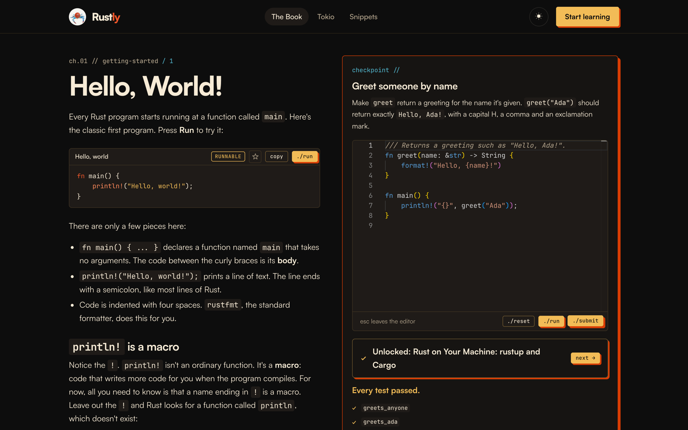
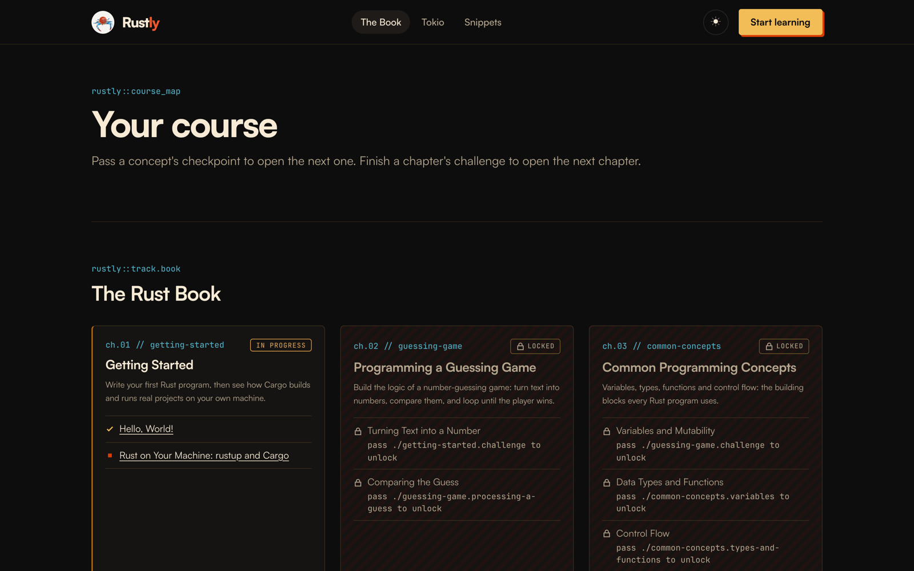

# Rustly

**Learn Rust in your browser.** Rustly turns [The Rust Programming Language](https://doc.rust-lang.org/book/) and the [Tokio tutorial](https://tokio.rs/tokio/tutorial) into short lessons with runnable examples, a real code editor and graded exercises. You don't need to install anything.

**Try it: [rustly-one.vercel.app](https://rustly-one.vercel.app)**



## What you can do

- **Read short lessons.** Each concept is a few hundred words in plain language, adapted from the Rust Book or the Tokio tutorial, with a link to the original chapter.
- **Run every example.** Snippets run in place. Some you can edit, and some are meant not to compile, so you can see the compiler error.
- **Write real Rust.** Every concept ends with an exercise in a full code editor (Monaco, the editor behind VS Code). **./run** shows the output. As you type, compiler errors and warnings appear as squiggles at the right spot, with a Problems list under the editor.
- **Get graded.** **./submit** runs hidden tests against your code and shows which ones passed. Passing a checkpoint unlocks the next concept, and passing a chapter's challenge unlocks the next chapter.
- **Get unstuck.** Hints appear one at a time, and the solution opens after three failed submits.
- **Keep your place.** Progress, drafts and starred snippets are saved in your browser. **Export / Import** moves them to another browser.
- **Look things up.** The [snippet library](https://rustly-one.vercel.app/snippets) lists every example from the lessons you've opened, searchable, with stars.



## The course

| Track | Follows | Status |
| --- | --- | --- |
| 1. The Rust Book | [doc.rust-lang.org/book](https://doc.rust-lang.org/book/) | Chapters 1–20 |
| 2. Async with Tokio | [tokio.rs/tokio/tutorial](https://tokio.rs/tokio/tutorial) | Hello Tokio, Spawning, Shared State, Channels, Select, I/O and Framing. It unlocks after Book chapters 10, 13 and 16 |

Exercises are pure functions graded by tests, because the Playground has no stdin, files or network. Tokio exercises use channels and in-memory I/O instead of sockets.

## How it works

Rustly is written entirely in Rust, front to back.

```text
Browser                              Vercel                          Rust Playground
┌──────────────────────────┐        ┌──────────────────────┐        ┌────────────────┐
│ Leptos app (WebAssembly) │  JSON  │ Rust functions       │  HTTP  │ compiles, runs │
│ lessons, editor, progress├───────►│ /api/run   /api/check├───────►│ and tests the  │
│ saved in localStorage    │        │ /api/submit          │        │ learner's code │
└──────────────────────────┘        │ /api/solution        │        └────────────────┘
                                    │ /api/format          │
                                    └──────────────────────┘
```

- **`frontend/`** is a [Leptos](https://leptos.dev) client-side app compiled to WebAssembly with [Trunk](https://trunkrs.dev). It renders lessons, hosts the Monaco editor and works out what's unlocked from the learner's progress.
- **`api/`** contains one Vercel function per endpoint. Each is a thin wrapper around the root crate (`src/`), which validates requests, caches results and calls the runner.
  - `run` executes code.
  - `check` returns compiler diagnostics for the editor.
  - `submit` appends an exercise's hidden tests to the learner's code and grades it.
  - `solution` returns a solution after three failed submits.
- **`crates/runner`** talks to the [Rust Playground](https://play.rust-lang.org) and parses its output into test results and diagnostics. Set `RUNNER_URL` to use a self-hosted Playground.
- **`crates/content`** loads the course from `content/` at compile time and builds the unlock graph. Hidden tests and solutions are only compiled in with the `server` feature, so they never reach the browser bundle.
- **`crates/shared`** holds the request and response types used by both sides.

## Writing a lesson

The course is plain files, so there is no database or CMS. Each concept is a folder:

```text
content/book/16-concurrency/
├── chapter.toml            # title, order, source link, summary
├── challenge.toml          # the chapter's final exercise
└── 01-threads/
    ├── lesson.md           # TOML front matter + markdown
    └── checkpoint.toml     # prompt, starter, hidden_tests, hints, solution
```

Rust code fences in `lesson.md` become live snippets. A plain `rust` fence is display-only. Add a kind to change that: `rust,runnable`, `rust,editable`, `rust,does_not_compile` or `rust,panics`. Add `title="..."` to give the snippet a heading.

`cargo test -p content` checks the course: every `requires` exists, nothing is unreachable and every concept has one checkpoint. Then check that every solution passes and every starter fails against the real Playground:

```sh
RUSTLY_ONLY=book.concurrency cargo test -p content --features server -- --ignored
```

[HANDOFF.md](HANDOFF.md) has the full content model, the curriculum and the original spec.

## Local development

Prerequisites: Rust stable (the `rust-toolchain.toml` adds the `wasm32-unknown-unknown` target) and [Trunk](https://trunkrs.dev) (`brew install trunk` or `cargo install trunk --locked`).

```sh
# 1. API: each function in api/ is its own binary. vercel_runtime serves it on VERCEL_DEV_PORT.
#    Run each in its own terminal (or only the ones you need).
VERCEL_DEV_PORT=3001 cargo run --bin health
VERCEL_DEV_PORT=3002 cargo run --bin check
VERCEL_DEV_PORT=3003 cargo run --bin run
VERCEL_DEV_PORT=3004 cargo run --bin submit
VERCEL_DEV_PORT=3005 cargo run --bin solution
VERCEL_DEV_PORT=3006 cargo run --bin format

# 2. Frontend: Trunk serves the app on :8080 and proxies each /api/* route to its port.
#    fetch-fonts.sh downloads Satoshi once (its license doesn't allow committing it).
./frontend/fetch-fonts.sh
cd frontend && trunk serve --port 8080
```

Open http://localhost:8080. The footer should say **API: ok**, and the course map is at `/learn`.

Try an endpoint directly:

```sh
curl -X POST localhost:3003 -d '{"code":"fn main() { println!(\"hi\"); }"}'
```

## Checks

CI runs these on every push and pull request:

```sh
cargo fmt --all --check
cargo clippy --all-targets -- -D warnings
cargo clippy -p frontend -p shared --target wasm32-unknown-unknown -- -D warnings
cargo test
(cd frontend && trunk build --release)
```

These call the real Playground, so run them by hand:

```sh
# Every exercise, snippet and starter.
cargo test -p content --features server -- --ignored
cargo test -p rustly-api -- --ignored
```

## Deploying

Vercel builds from `main`. `vercel-install.sh` installs the toolchain and Trunk, `vercel-build.sh` builds the frontend into `frontend/dist`, and each file in `api/` becomes a Rust function. `vercel.json` sends every non-API path to the app.

## Credits

The lessons are adapted from [The Rust Programming Language](https://github.com/rust-lang/book) (MIT OR Apache-2.0) and the [Tokio tutorial](https://github.com/tokio-rs/website) (MIT). Code runs on the [Rust Playground](https://play.rust-lang.org), and the editor is [Monaco](https://microsoft.github.io/monaco-editor/). The full list, with fonts, is on the [credits page](https://rustly-one.vercel.app/credits), and the license texts are in [THIRD_PARTY_LICENSES.md](THIRD_PARTY_LICENSES.md).
